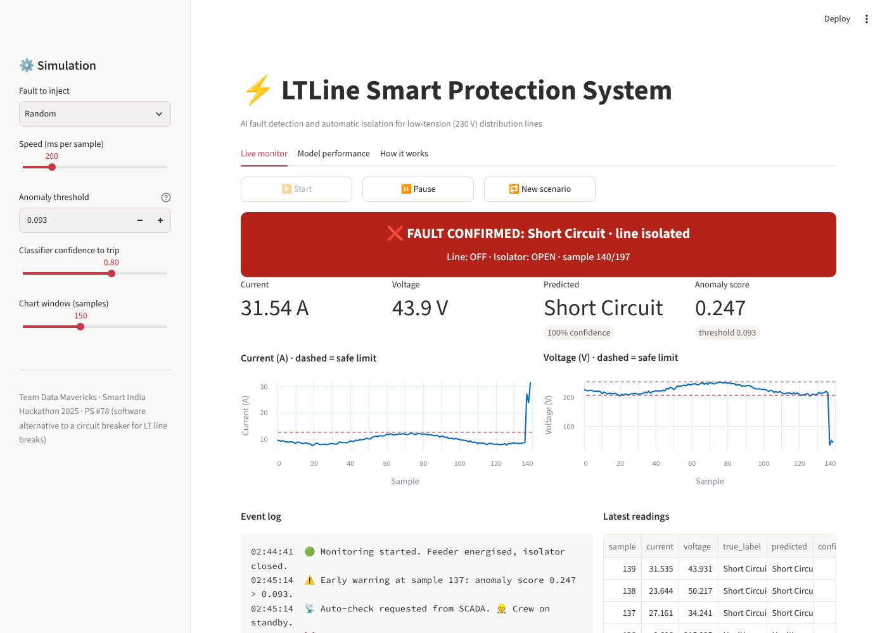
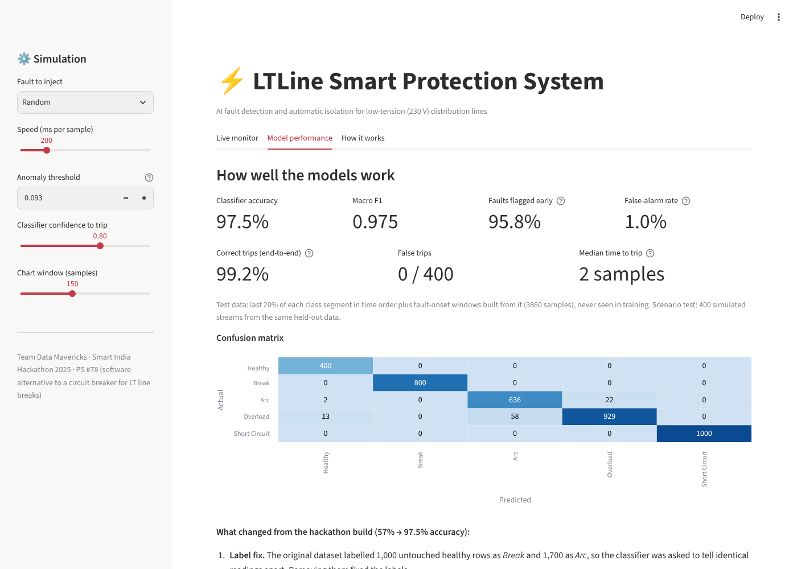

# ⚡ LTLine: Smart Protection System for LT Lines

AI fault detection and automatic isolation for low-tension (230 V) power distribution lines.
Built by **Team Data Mavericks** for **Smart India Hackathon 2025** (reached Round 2).

**Problem statement #78:** *Software, other than a circuit breaker, that can detect and turn off
LT lines when the line breaks.* Theme: Smart Automation in Power Systems.

> **v2 in progress** (branch `v2-physics`): real 3-phase 50 Hz waveforms with downed-conductor
> (high-impedance) faults and look-alike disturbances. On 640 held-out events, LightGBM on relay-style
> features trips **99.2% of faults** and **98.1% of broken conductors** with **zero false trips**,
> where a conventional relay catches **0%** of broken conductors.
> See [docs/simulator.md](docs/simulator.md) and [docs/results.md](docs/results.md).



## The problem

A snapped LT conductor lying on the ground can stay live, because a broken line often doesn't draw
enough current to trip a conventional breaker. Breakers also react only *after* a fault. They don't say what
kind of fault it was, and they don't warn the people nearby.

## How it works: three layers

| Layer | What it does | How |
|---|---|---|
| **1. Detect** | Early warning when readings stop looking normal | Isolation Forest trained **only on healthy data**, so it needs no fault labels |
| **2. Protect** | Confirms the fault type and trips the isolator | Random Forest (5 classes). Trips only if the anomaly persists ≥ 3 samples **and** 3 consecutive predictions agree with ≥ 80% confidence |
| **3. Respond** | Tells everyone who needs to know | SCADA relay, SMS/WhatsApp to residents, crew dispatch with GPS (simulated in this demo) |

Fault classes: **Healthy · Break · Arc · Overload · Short Circuit**

Features for each sample are current, voltage, and the rolling standard deviation and mean absolute change over the last
5 samples. The window features are what make arcing detectable: an arc shows up as a jagged waveform
rather than one bad reading.

## Results

Evaluated on held-out data (the last 20% of each class segment in time order, never used in training):

| Metric | Value |
|---|---|
| Classifier accuracy | **97.5%** (macro F1 0.975) |
| End-to-end correct trips (400 simulated healthy → fault streams) | **99.2%** |
| False trips | **0 / 400** |
| Median time to trip after fault onset | **2 samples** |
| Faults flagged by the anomaly detector | 95.8% |
| Healthy samples wrongly flagged | 1.0% (warning only; no trip) |



### What changed from the hackathon prototype (57% → 97.5%)

The original prototype scored **57%** test accuracy and missed most arcs. Digging into the data showed why:

1. **Label noise.** The synthetic dataset was built by injecting faults into copies of one healthy
   waveform, but 1,000 *Break* rows and 1,700 *Arc* rows were left unchanged. Identical readings were
   labelled both *Healthy* and *Arc*, which no model can learn. Removing them fixed the labels.
2. **Time-aware features.** Rolling-window features capture waveform *shape*, which a single point can't.
3. **Fault-onset training.** Windows that straddle the healthy → fault boundary were added to training,
   so the step change at onset isn't mistaken for arcing. This cut Overload → Arc mis-trips from ~25% to ~3%.
4. **Leak-free evaluation.** The data is split in time order, not shuffled row by row, because neighbouring
   readings are nearly identical and a random split would leak.
5. **Stricter trip rule.** Three agreeing confident predictions removed false trips.
6. **Smaller model.** 1.2 MB of artifacts, down from 123 MB, so they fit in a normal GitHub repo.

## Run it locally

```bash
python -m venv .venv
# Windows: .venv\Scripts\activate   |   macOS/Linux: source .venv/bin/activate
pip install -r requirements.txt
python train.py          # optional: models are already in ./models
streamlit run app.py
```

In the app: pick a fault (or *Random*) in the sidebar, press **Start**, and watch the line go
healthy → early warning → fault confirmed → isolated. **New scenario** restores the line.

## Project structure

```
app.py              Streamlit dashboard (live monitor, model performance, how it works)
train.py            Cleans data, trains both models, runs the held-out scenario test
ltline/core.py      Data loading + label cleaning, features, shared trip logic
data/               lt_faults_augmented.csv: 10,000 synthetic readings, 5 classes
models/             Trained models + metrics (meta.json, confusion matrix, report)
```

## Limitations

- The data is **synthetic** (generated for the hackathon), so the high scores show the pipeline works,
  not field accuracy. A real deployment would retrain on utility CT/PT logs.
- Alerts and the relay are simulated. The proposed hardware is a CT, PT, microcontroller and relay
  per pole (about ₹7k–15k), with local-first tripping and cloud/SCADA redundancy.

## Tech

Python · scikit-learn (Isolation Forest, Random Forest) · pandas · Streamlit · Altair

**References:** Lee et al., *Smart Metering System Capable of Anomaly Detection by Bi-directional
LSTM Autoencoder* (arXiv:2112.03275); Ponukumati & Sinha, *An Intelligent Fault Detection and
Classification Scheme for Distribution Lines Using Machine Learning*, ETASR 12(4), 2022.
