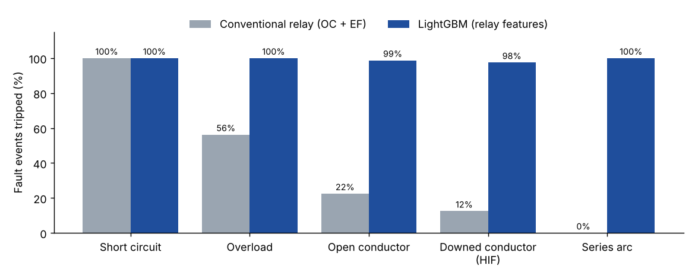
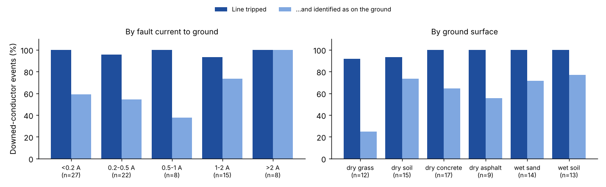
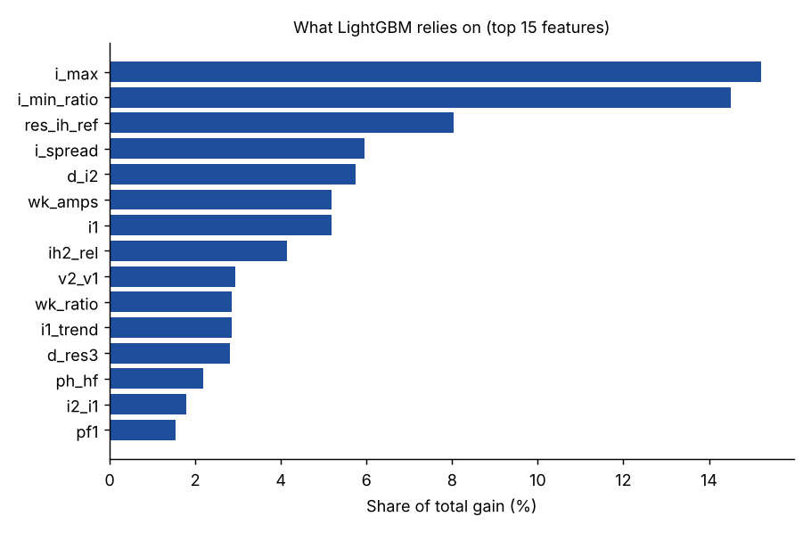

# LTLine v2, Phase 2: features, models and results

## Setup

- **Data:** 3,200 simulated events (see [simulator.md](simulator.md)). The test set is **640 events**
  (400 faults, 240 normal including look-alikes) that were never used for training or tuning.
- **Features:** 46 relay-style features per 80 ms window, computed causally every 20 ms
  ([ltline/features.py](../ltline/features.py)): frequency-tracked DFT phasors, sequence components,
  superimposed (now minus 0.3-0.7 s ago) neutral-current phasors and harmonics,
  arc signatures (cycle-to-cycle randomness, inter-harmonic energy, even harmonics/DC,
  zero-current shoulders, HF energy), and features for the weakest (broken) phase.
- **Trip rule:** trip when the same fault class wins with probability ≥ θ for K consecutive
  cycles. Short circuits use K = 2, an instantaneous element. θ and K are tuned on a validation
  split of the *training* events: zero false trips first, then the most faults caught.
- **Metrics are event-level**, as in protection studies: *dependability* (faults tripped),
  *right type*, and *security* (false trips on normal events, including trips before a fault starts).

## Results (test set, 640 events)

| Approach | Faults tripped | Right type | Broken conductor caught | False trips | Short-circuit trip time |
|---|---|---|---|---|---|
| Conventional relay (overcurrent + earth fault, tuned) | 38.2% | 17.5% | **0.0%** | 1 / 240 | 41 ms |
| v1-style ML (RMS current/voltage only) | 77.0% | 55.8% | 88.8% | **114 / 240** | 47 ms |
| Random Forest (relay features) | 96.0% | 83.2% | 90.6% | 1 / 240 | 30 ms |
| **LightGBM (relay features)** | **99.2%** | **82.8%** | **98.1%** | **0 / 240** | **30 ms** |
| 1D-CNN (raw waveforms) | 98.0% | 79.2% | 99.4% | 18 / 240 | 30 ms |



Faults tripped, per class:

| Approach | Short circuit | Overload | Open conductor | Downed conductor | Series arc |
|---|---|---|---|---|---|
| Conventional relay | 100% | 56.2% | 22.5% ¹ | 12.5% ¹ | 0% |
| v1-style ML | 97.5% | 93.8% | 90.0% | 90.0% | 13.8% |
| Random Forest | 98.8% | 100% | 90.0% | 91.2% | 100% |
| **LightGBM** | **100%** | **100%** | **98.8%** | **97.5%** | **100%** |
| 1D-CNN | 92.5% | 100% | 100% | 98.8% | 98.8% |

¹ Only by luck: the earth-fault element picks up the *load unbalance* that the break leaves
behind, not the fault itself. It never trips as a broken conductor, so its "broken conductor caught" score is 0%.

## What the results say

1. **Conventional protection is blind to the dangerous faults.** It clears short circuits but
   misses most broken and downed conductors and every series arc. Its earth-fault element
   can't be set below 120 A without nuisance trips, because normal unbalance and
   3rd harmonics already put 40-60 A in the neutral. A downed conductor adds a median of 0.4 A.
2. **The v1 approach (RMS only) doesn't work on real waveforms.** It catches faults but
   false-trips on 114 of 240 normal events. Motor starts, load steps and capacitor
   switching all look like faults when all you have is RMS.
3. **Relay-style features + LightGBM is the best system:** 99.2% of faults tripped,
   98.1% of broken conductors caught, **zero false trips** on every look-alike,
   short circuits cleared in 30 ms. The most important features are physical: current level,
   the broken phase's current ratio, inter-harmonic neutral current, negative sequence
   change, and the current left on the weakest phase.
4. **The CNN learns the faults but not the look-alikes.** Trained on raw waveforms, it
   catches 99.4% of broken conductors but makes 18 false trips (mostly load steps), even
   after hard-negative sampling. With this much data, engineered physics features beat
   end-to-end deep learning on security, which matters most for protection.

## Honest limits

- **Downed vs open conductor.** The line trips for 97.5% of downed conductors, but the model
  identifies "on the ground" correctly only ~60% of the time. The rest are called open
  conductors. Telling them apart depends on 0.2-2 A of arc current next to the lost
  load, and in the model the identification only becomes reliable above ~2 A (100%).
  Both cases need the line de-energised, so for safety the trip is what matters.
  A downstream sensor (Phase 4) is the planned way to tell them apart.

  

- **Simulation only so far.** Phase 3 tests the approach on real measurements (VSB dataset).
- **Small test classes** (80 events per fault, 40 per look-alike), so ±3-5% differences between
  close models aren't significant.
- **Response time.** Most non-short-circuit faults trip in ~240-300 ms. That's fine for
  open/downed conductors (published HIF detectors take seconds) but slower than ideal for arcs.

## Reproduce

```bash
pip install -r requirements.txt lightgbm torch
python scripts/generate_dataset.py   # 25 s   -> data/sim_manifest.csv
python scripts/build_features.py     # 1.5 min -> data/features.parquet (not in git, 125 MB)
python scripts/train_models.py       # 4 min  -> models/v2/
python scripts/train_cnn.py          # 5 min
python scripts/report.py             # tables + figures in docs/
```


