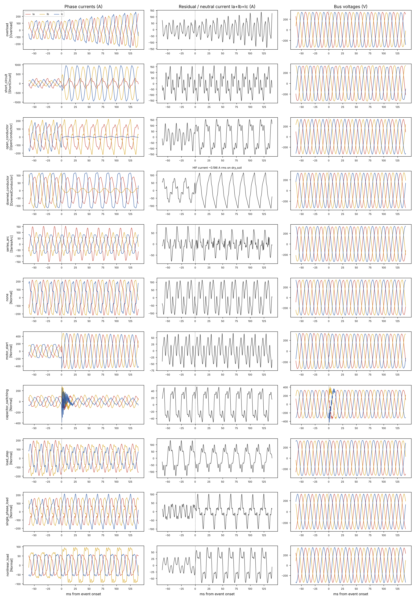

# LTLine v2: LT feeder waveform simulator

The v1 dataset had one current/voltage pair per time step and no electrical physics.
v2 replaces it with a simulator of real 3-phase waveforms. This is the data a
protection relay actually sees.

## What is simulated

| Item | Value |
|---|---|
| Network | 415 V L-L / 230 V L-N, 50 Hz LT feeder from a distribution transformer |
| Measurement point | LT bus at the transformer (where the protection unit sits) |
| Channels | Va, Vb, Vc, Ia, Ib, Ic (neutral/residual current = Ia+Ib+Ic) |
| Sampling | 3.2 kHz = 64 samples per cycle (typical relay / PMU rate) |
| Event length | 3 s, with the event starting at a random time between 0.8 and 1.6 s |
| Feeder rating | 200 A |

**Healthy network:** unbalanced loads (±25%), lagging power factor (0.82–0.98),
slow load drift, harmonic currents from non-linear loads (3rd 4–20%, 5th, 7th, 9th),
background voltage distortion, grid frequency ±0.15 Hz, transformer source impedance
(so heavy current pulls the bus voltage down), and sensor noise (45–60 dB SNR).
Because the loads are unbalanced and the 3rd harmonics add up in the neutral,
**40–60 A of neutral current is normal**. That's the noise floor any ground-fault detector has to beat.

## Classes

| Class | Physics | Why it's hard |
|---|---|---|
| **Overload** | Balanced current ramps to 1.15–1.7× rating | Easy, but must be told apart from motor starts |
| **ShortCircuit** | L-G / L-L / 3-phase fault through cable + contact resistance, with decaying DC offset | Remote faults only reach ~2.3× rating |
| **OpenConductor** | One phase parts; only loads upstream of the break (0–35%) stay connected | Current *falls*, so overcurrent protection can't see it |
| **DownedConductor** | Broken conductor lying on asphalt, concrete, grass, soil or sand: a **high-impedance fault (HIF)**. Two-diode Emanuel arc model with asymmetric arc voltages (40–110 V), random resistance per half cycle, build-up as the contact settles, and random extinctions | Fault current median **0.40 A** (90th pct 2.1 A), buried under 40–60 A of normal neutral current |
| **SeriesArc** | Loose or burnt joint arcing in series with the load: zero-current "shoulders" of 0.2–1.5 ms after each zero crossing, broadband arc noise, half-cycle flicker | Almost no change in RMS current |
| **Normal** | Steady operation **plus five look-alikes that must not trip**: motor start (5–7× inrush), capacitor bank switching (300–900 Hz ringing), balanced load step, big single-phase load (raises neutral current like a ground fault), non-linear load (raises 3rd harmonic like an arc) | These are the classic sources of false alarms in published HIF work |



## Dataset

```bash
python scripts/generate_dataset.py      # ~25 s
```

3,200 events: 400 per fault class and 1,200 Normal (200 of each disturbance type),
with 80/20 train/test split per event. The manifest (`data/sim_manifest.csv`) stores
each event's seed, label, onset and physical parameters (fault phase, surface,
fault current, motor size, ...). Waveforms are regenerated on demand. The simulator
is deterministic and takes ~6 ms per event, so the repo stays small and the data
is fully reproducible. Use `--export-npz DIR` to write raw waveforms.

## Validation

`pytest tests/` runs 92 physics checks across many random events: healthy voltage within ±10%,
short-circuit current > 2× rating, overload > rating, open conductor drops its
phase current below 45%, HIF current < 15 A with the phase current *falling*,
HIF asymmetry and half-cycle randomness, series-arc shoulders, capacitor switching
adding no neutral current, and look-alikes keeping the voltage normal.

## Modelling choices and limits

- The source is an ideal EMF behind the transformer impedance; the feeder is not
  modelled section by section yet (needed for fault location in Phase 4).
- The HIF model follows the Emanuel two-diode model widely used in HIF studies;
  surface resistance ranges are scaled from published values to 230 V.
- No CT saturation, no load-side voltage measurement, single feeder only.
- This is still simulation. Phase 3 checks the approach against the public
  VSB power-line fault dataset (real measurements).
